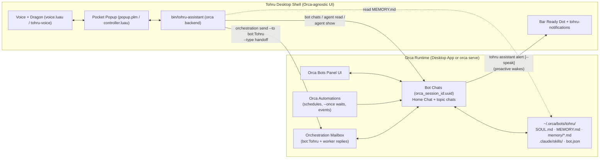

# Assistant Bot Abilities: Investigation & Plan

Status: implemented (default `local` + opt-in `orca` backend, `tohru assistant orca init`, `tohru assistant alert`, background sync, Home Manager options, and unit tests; Section 7 local schedules remain a separate follow-up). Related: [ai-assistant.md](ai-assistant.md), [architecture.md](architecture.md), [../shell/assistant/README.md](../shell/assistant/README.md).

## Executive Summary

**Recommendation:** Split Tohru's assistant behind a clean **pluggable backend interface** in [`bin/tohru-assistant`](../bin/tohru-assistant) with **`local` as the default** (zero Orca assumptions or dependencies for general Tohru users) and **`orca` as an explicit opt-in backend** that routes Tohru's desktop popup and voice directly to a real **Tohru** bot in Orca's **Bots** panel (`~/.orca/bots/tohru/`).

- **For non-Orca Tohru users (default):** Nothing changes out of the box—no Orca UI chrome, no `orca` probes, and the existing 5-CLI + SQLite assistant stays intact. Proactive desktop notifications/speech (`tohru assistant alert`) live in the shared shell layer, and **Orca-free local schedules & task watches** are scoped as a **separate follow-up** (Section 7) so non-Orca users can also get overnight watches and reminders later without needing Orca.
- **For Orca users (opt-in `assistant.backend = "orca"`):** There is **one Tohru**—same persona, memory, abilities, and conversation history—reachable either from Orca's Bots panel or from Tohru's desktop Pocket popup and voice interface. Because every turn executes inside Orca's native bot chat (`orca_session_id:<uuid>`), Tohru gets a real durable mailbox (`bot:Tohru`), automatic overnight wakes on agent replies/workers/schedules/events, bot-scoped tools and connectors, and native Orca editor/fleet control.

Everything needed for v1 works today using **100% documented Orca CLI commands** (verified on Orca `1.4.268`). Three UX gaps in Orca `1.4.268`'s current CLI (token streaming, remote turn cancellation, and non-mail owner turn submission) are documented honestly in Section 5.4 and isolated behind the backend adapter so Tohru can adopt them cleanly when Orca exposes them.

---

## 1. Current State & Root Causes

### How Tohru works today
- **Ephemeral per-turn runner:** [`bin/tohru-assistant`](../bin/tohru-assistant) spawns a one-shot headless CLI (`claude -p --resume <id>`, `codex exec resume`, etc.) in `$XDG_STATE_HOME/tohru/assistant/scratch`. Once a reply ends, the child process group exits; any background monitor or `orca orchestration check --wait` dies with it.
- **Why Orca replies fail with `terminal_not_found`:**
  - Running `orca status --json` outside an Orca session returns `caller: null` (no `ORCA_AGENT_SESSION_ID`, `ORCA_TERMINAL_HANDLE`, or bound Run).
  - When Tohru runs `orca orchestration send --from tohru --to <target>`, Orca accepts the outbound send and records `run_id: "run_unbound"`, `from_handle: "tohru"`.
  - When the recipient runs `orca orchestration reply --id <msg_id>`, Orca tries to route the reply back to `from_handle = "tohru"`. Because `"tohru"` is not a registered `bot:<name>`, `orca_session_id:<id>`, `run:<id>`, `dispatch:<id>`, or live `term_...` handle, delivery fails with `terminal_not_found`.
- **Private siloed state:** Conversations, FTS5 search, extracted facts/preferences, summaries, and relationship state live in `$XDG_DATA_HOME/tohru/assistant.sqlite`, and `CLAUDE_CODE_DISABLE_AUTO_MEMORY=1` prevents Claude from keeping a second memory. Orca's UI, other agents, and `orca search` cannot see any of it.
- **Voice loop:** [`shell/assistant/voice.luau`](../shell/assistant/voice.luau) waits for `assistant.on_answer` (`kind == "done"`) before sending `{cmd = "say", text = answer}` to [`bin/tohru-voice`](../bin/tohru-voice), which splits sentences and synthesizes speech with Kokoro.

### What an Orca Bot actually provides (verified on Orca `1.4.268`)
Verified via `orca skills get orca-cli --full`, `orca skills get orchestration --full`, `orca agent-context --json`, `orca status --json`, and inspecting a live local bot (`~/.orca/bots/chad/`):

| Capability | How Orca Bots implement it |
|---|---|
| **Home & Identity** | Folder workspace at `~/.orca/bots/<slug>/` (`repo: "Bots"`, `botHome: true` in `orca worktree ps`). Contains Orca-managed `bot.json`, `AGENTS.md`, `CLAUDE.md` (`@AGENTS.md`), and bot-owned `SOUL.md`. |
| **Memory** | `~/.orca/bots/<slug>/MEMORY.md` (dated one-line facts, newest first) + `memory/<topic>.md` (longer notes), maintained by the bot. |
| **Abilities & Tools** | Bot-scoped skills in `.claude/skills/<name>/` (Claude) or `.agents/skills/<name>/` (Codex), bot-scoped MCP servers (`orca bot tools add\|rm\|connect`), and connectors (`orca bot connectors`: Slack, GitHub, Linear, Google, webhooks). |
| **Conversations** | Native Orca structured chat sessions (`orca_session_id:<uuid>`): one pinned **Home Chat** (`home: true`) plus optional topic/automation chats. Listed via `orca bot chats --bot <Name> --json` and read via `orca agent read orca_session_id:<uuid> --json` (both work from outside Orca with no `ORCA_*` env vars). |
| **Durable Mailbox** | Addressable as `bot:<Name>` (or `bot:<id>`), with `--chat <id\|new>` and `--item <n>`. When the bot runs inside its Orca chat, Orca injects `ORCA_AGENT_SESSION_ID`—so outbound `orchestration send` and `worker-start` carry a real return address. Replies, `worker_done`, `question`, and `escalation` wake the bot's chat automatically, even overnight. |
| **Schedules & Events** | `orca automations create --bot <Name>` supports presets/cron/RRULE (`--trigger`), `--precheck`, one-shot reminders (`--once --by <ISO>`), one-shot event waits with deadline (`--once --by <ISO> --on "github.workflow_finished ..."`), and recurring event triggers (`slack.*`, `github.*`, `linear.*`, `gmail.new_email`, `calendar.starting_soon`, `webhook.call`). Supports per-automation `--agent`, `--model`, `--effort`, `--runs-in new\|chat\|chat:<id>`, and `--results-to chat\|thread\|channel:...\|none`. |
| **Orca Editor & Fleet** | Native `orca worktree create\|set\|ps` (including taking over workspaces under its bot home via `--parent-worktree current`), `orca file open\|diff\|open-changed`, `orca agent launch\|list\|read`, `orca tab` (built-in browser), `orca computer`, paired servers (`--on <server>`), and mobile access (`bots.mobile.v1`). |

---

## 2. Architecture Options Comparison

| Dimension | Option A: Pluggable Backend — Default `local` + Explicit Opt-In `orca` Bot *(Recommended)* | Option B: Add All Bot Pieces Directly to Tohru (Daemon + Local Cron + Mailbox) | Option C: Split-Brain Hybrid (Local Tohru + Companion Orca Bot + Sync) |
|---|---|---|---|
| **Zero Orca assumption for non-Orca Tohru users** | **Yes** — `assistant.backend = "local"` by default; Orca is never probed or shown unless opted in | **Yes** | Partially (requires Orca for bot features) |
| **Appears in Orca's Bots panel as Tohru itself** | **Yes** (when `orca` backend is enabled) — real bot in `~/.orca/bots/tohru/` | **No** — invisible lookalike | Partial — a *second* instance whose chat diverges from desktop |
| **Single source of truth (persona, memory, history, abilities)** | **Yes** — `assistant.sqlite` in `local` mode; Orca bot home + bot chats in `orca` mode (never both at once) | Local SQLite only; Orca can't see it | **No** — dual stores (`assistant.sqlite` vs `MEMORY.md` + separate chat sessions) drift constantly |
| **Working Orca mailbox & overnight wakes** | **Native** in `orca` mode (`bot:Tohru` + `orca_session_id:<id>`) | **Fragile/hacky** — Orca has no CLI to register an external mailbox (`consumer_fenced` blocks unbound Run checks; requires keeping a dummy Orca terminal alive) | Only for delegated tasks; replies wake the bot, not local Tohru |
| **Schedules, waits & external events** | Native `orca automations --bot Tohru` in `orca` mode; optional lightweight local scheduler in `local` mode (follow-up) | Must build and maintain scheduler, webhook receiver, and connectors from scratch | Split across two systems |
| **Orca editor & multi-host orchestration** | **Native** in `orca` mode (`--parent-worktree current`, `--on <server>`, `bot connectors`, `bot tools`) | External-only; no bot home lineage or bot connectors | Split |
| **Streaming & barge-in Stop latency** | Full streaming + `SIGINT` in `local` mode; turn-level via `orchestration send --type handoff` + `agent read` poll in `orca` mode today (upgrades when Orca adds CLI streaming/stop) | Full streaming + `SIGINT` | Streaming locally, slower/split for delegated work |

### Why Option A wins
1. **Respects non-Orca users:** Tohru remains a completely independent desktop shell. Choosing `"local"` as the default (instead of `"auto"`) avoids surprising anyone who happens to have Orca installed, while giving Orca users a first-class, opt-in integration.
2. **Respects the "one Tohru" constraint for Orca users:** When `assistant.backend = "orca"` is enabled, there is no dual-store sync and no split-brain assistant—everything lives in `~/.orca/bots/tohru/` and Orca's native bot chats.
3. **Avoids reinventing Orca while keeping room for universal features:** The shell-side proactive alert channel (`tohru assistant alert`) is shared by both backends, and lightweight local schedules/watches for `local` mode can be added cleanly as a separate follow-up without blocking Orca bot integration.

> **Why not an Orca Plugin worker as the bridge?**
> Verified via `orca skills get orca-plugin-authoring --full` (`references/events.md`, `references/host-api.md`): plugin workers only receive `agent.status.changed` for *terminal panes* and have no API to send, read, or stream native structured/bot chat sessions. The `orca` CLI is strictly more capable for bot integration today.

---

## 3. Clean Separation of Layers & Single Source of Truth

### Shared Shell Layer (all Tohru users, Orca-agnostic)
- Pocket popup ([`shell/assistant/popup.plm`](../shell/assistant/popup.plm)), bar dragon & unread ready dot ([`shell/assistant/state.plm`](../shell/assistant/state.plm), [`shell/assistant/controller.luau`](../shell/assistant/controller.luau)), voice & animated dragon ([`shell/assistant/voice.luau`](../shell/assistant/voice.luau), [`bin/tohru-voice`](../bin/tohru-voice), [`shell/assistant/puppet.luau`](../shell/assistant/puppet.luau)).
- `tohru-assistant` JSON line protocol (`providers`, `chat`, `history`, `show`, `memory`, `sync`).
- `tohru assistant alert [--chat ID] [--speak] [--title T] <message>`: sets `ai_ready` on the bar dragon, posts a desktop notification via `tohru-notifications`, and optionally speaks via `tohru-voice` (respecting lock screen & Do Not Disturb).
- Conversation ID validators accepting both 32-char hex IDs (`local`) and standard hyphenated UUIDs (`orca`).

### Single Source of Truth in `orca` Mode



| Data | `local` backend (default) | `orca` backend (opt-in) |
|---|---|---|
| **Identity & Persona** | `shell/assistant/persona.md` (or `assistant.persona_file`) | `~/.orca/bots/tohru/SOUL.md` (seeded from `persona.md` + desktop/voice/alert rules) |
| **Long-term Memory** | `$XDG_DATA_HOME/tohru/assistant.sqlite` (`memories`, `summaries`, `relationship`) | `~/.orca/bots/tohru/MEMORY.md` + `memory/*.md` (post-turn SQLite extraction disabled) |
| **Conversations & History** | `assistant.sqlite` (`conversations`, `turns`, FTS5) | Orca bot chats (`orca bot chats --bot Tohru`, `orca agent read orca_session_id:<uuid>`) |
| **Abilities & Tools** | User's host CLIs & MCP configs | `~/.orca/bots/tohru/.claude/skills/` (or `.agents/skills/`) + `orca bot tools` + `orca bot connectors` |
| **Schedules & Wakes** | Separate follow-up (Section 7) | Native `orca automations create --bot Tohru` + native orchestration mailbox |

---

## 4. Technical Mechanics & Verified Constraints (`orca` Backend)

### 4.1 Creating & Bootstrapping the `Tohru` Bot
Orca `1.4.268` intentionally requires human approval to create a bot (no headless `orca bot create --yes`):
1. **Create once in Orca:** Create a bot named **Tohru** in Orca's Bots panel (picking the agent/model, e.g. `claude`, and avatar), or propose it from an existing bot chat with `orca bot create --offer --name Tohru --purpose "..."` and accept the card. Orca creates `~/.orca/bots/tohru/`.
2. **Bootstrap via `tohru assistant orca init [--bot Tohru]`:**
   - Verifies the bot exists via `orca bot list --json` and resolves `~/.orca/bots/<slug>/`.
   - Seeds `SOUL.md` from [`shell/assistant/persona.md`](../shell/assistant/persona.md) plus desktop shell commands (`tohru ...`), the voice brevity rule (triggered when a message is tagged as spoken via desktop voice), and proactive desktop alert rules (`tohru assistant alert`).
   - Optionally migrates existing facts, summaries, and relationship notes from `~/.local/share/tohru/assistant.sqlite` into `MEMORY.md` and `memory/imported-tohru-sqlite.md` (keeping the SQLite file untouched as backup).
3. **Enable in config:** Set `assistant.backend = "orca"` (and `assistant.orca_bot = "Tohru"`, or `programs.tohru.assistant.orca.enable = true` in Home Manager).

### 4.2 Routing Popup & Voice Turns to `bot:Tohru`
- **Chat selection:**
  - Default active chat = Tohru's **Home Chat** (`home: true` from `orca bot chats --bot Tohru --json`) so opening the popup or speaking continues the same thread visible in Orca's Bots panel.
  - Clicking **+** (New chat) sets `conversation = null`; the next send passes `--chat new --subject "<title>"`, creating a new chat under Tohru in Orca's Bots panel.
  - Clicking a row in **History** loads that Orca chat UUID and sends follow-ups with `--chat <uuid>`.
  - **Voice routing:** Configurable via `assistant.orca_voice_chat = "home" | "new"` (recommended default: `"home"` so voice and the Bots panel immediately share context).
- **Sending via `--type handoff` (not `--type question`):**
  ```sh
  orca orchestration send --to bot:Tohru [--chat <id|new>] --from tohru-desktop --type handoff --subject "<label>" --body-file <tmp> --json
  ```
  - `--type question` tells the bot to answer with `orca orchestration reply`, which **fails with `terminal_not_found`** when `--from` is not a registered Orca mailbox and adds an extra LLM tool-call round-trip.
  - `--type handoff` wakes the bot chat so Tohru answers **directly as her normal assistant turn**—zero extra tool call, zero `terminal_not_found`, and immediately visible in Orca's Bots panel.
  - Voice turns prepend a concise, machine-strippable cue (e.g. `[voice]`) so `SOUL.md` keeps spoken replies to 1–3 short plain sentences with no Markdown or links.
- **Receiving the answer:**
  - Snapshot the chat's current entries via `orca agent read orca_session_id:<id> --json` before sending.
  - After sending, poll `orca agent read` (and `orca agent show` if needed) every ~250–300 ms while `state == "working"`, keeping the bar glow active (`ai_streaming = true`), emitting any newly appended assistant text as `delta`, and emitting `done` once the new assistant entry completes and `state != "working"`.
  - When loading history (`show`), strip the `[tohru-desktop]` / `[voice]` envelope from desktop-originated turns while showing turns typed in Orca's Bots panel verbatim.

### 4.3 Proactive Wakes (Overnight Tasks, Schedules, Agent Replies)
1. **Push path (instant, bot- or timer-initiated):** `tohru assistant alert [--chat <id>] [--speak] [--title <title>] <message>` talks to the bar via Pleamar `--say tohru`:
   - Sets `ai_ready = true` and `ready_for = <chat_id>` so clicking the bar dragon opens that exact chat.
   - Sends a desktop notification via `tohru-notifications` (respecting DND).
   - If `--speak` is set AND voice is enabled AND the session is neither locked (`ai_voice_paused`) nor in DND (`notices_dnd`), speaks a brief announcement via `tohru-voice` with the dragon overlay.
2. **Pull safety net (`orca` backend):** While idle (e.g. every ~15 s, plus on popup open), `controller.luau` runs a lightweight `tohru-assistant sync` (`orca bot chats --bot Tohru --json`) to compare `lastActivityAt`. Any new assistant reply from Orca's Bots panel or an automation lights up `ai_ready` and refreshes the open chat automatically.

### 4.4 Verified Gaps & Mitigations (Orca `1.4.268`)

| Gap in Orca `1.4.268` | Impact on Desktop UX | Mitigation in v1 | Ideal Upstream Orca CLI Addition |
|---|---|---|---|
| **No `orca bot send --stream` CLI** | No character-by-character streaming in Pocket popup; shows "Answering…" until turn completes; voice adds ~250–300 ms poll latency after turn completion. | Keep "Answering…" / thinking indicator; poll `agent read` at 250 ms; `voice.luau` already waits for `done` before TTS today. | `orca bot send --bot <name> [--chat <id\|new>] --stream --json` (backed by existing `agent-session.text-append.v1`). |
| **No `orca agent stop` CLI** | Popup **Stop** and voice **barge-in** can hush TTS and detach the desktop UI, but cannot abort the bot's underlying LLM turn. | Immediately stop local TTS (`hush`) and exit `tohru-assistant` cleanly with `stopped`; underlying Orca turn finishes in background. | `orca agent stop <orca_session_id>` (exposing existing `agent-session.conversation-stop.v1` / `prompt-cancel.v1`). |
| **Mail envelope in Bots panel** | Desktop turns sent via `orchestration send --type handoff` appear in Orca's Bots panel with a mail header (`From: tohru-desktop`) rather than a raw owner chat bubble. | Keep subject/body concise; strip the envelope when rendering in the Pocket popup. | `orca bot send --as-owner` (submits native owner turn). |
| **`MEMORY.md` deletion reconciliation** | Bot `AGENTS.md` states Orca restores lines deleted from `MEMORY.md` outside `orca bot memory forget`, yet `bot memory` is not a public top-level CLI subcommand in `1.4.268`. | **Verify in Phase 0:** test whether direct edits persist or revert; if reverted, route desktop "Forget" through the bot instead of editing behind Orca's back. | Expose `orca bot memory list\|forget --bot <name>` publicly. |
| **UUID conversation IDs** | `bin/tohru`, `bin/tohru-assistant`, and `shell/assistant/controller.luau` currently only accept 32-char hex IDs (`^[0-9a-f]{32}$`). | Update validators in all three files to accept both 32-char hex IDs and standard UUIDs. | N/A (Tohru-side fix). |
| **Orca runtime liveness** | Bot automations and mail require Orca desktop or `orca serve --supervise` (`orca serve service install`). | Surface a clear "Orca not running" status in `orca` mode rather than silently splitting state into SQLite (with an optional offline fallback setting if desired). | N/A (already supported by `orca serve --supervise`). |

---

## 5. Phased Implementation Plan

### Phase 0: Live Orca Bot Spike (Verification Only)
Create the `Tohru` bot once in Orca's Bots panel and verify four behaviors on `1.4.268` before writing implementation code:
1. Exact JSON receipt of `orca orchestration send --to bot:Tohru --type handoff --chat new --subject "..." --body-file ... --json` (whether the new chat UUID is returned directly or discovered via `orca bot chats`).
2. Exact `orca agent read` payload while `state == "working"` vs `"done"` (whether intermediate entries appear mid-turn or only on completion).
3. Whether direct edits/deletions in `~/.orca/bots/tohru/MEMORY.md` persist or get restored by Orca.
4. End-to-end voice turn latency (end-of-speech -> `orchestration send` -> bot reply -> `agent read` -> Kokoro first audio).

### Phase 1: Backend Interface, Settings & Bot Bootstrap
- Refactor [`bin/tohru-assistant`](../bin/tohru-assistant) into a shared CLI/protocol front end over two backends: `LocalCliBackend` (default, unchanged behavior) and `OrcaBotBackend` (loaded only when configured).
- Add settings in [`runtime/src/settings.rs`](../runtime/src/settings.rs), [`nix/home-manager.nix`](../nix/home-manager.nix), and [`docs/configuration.md`](configuration.md):
  - `assistant.backend`: `"local"` (default) | `"orca"`
  - `assistant.orca_bot`: `"Tohru"` (bot name when `backend = "orca"`)
  - `assistant.orca_voice_chat`: `"home"` | `"new"` (default `"home"`)
  - `assistant.orca_offline`: `"error"` (default, prevents split-brain) | `"local"` (optional local fallback)
- Add `tohru assistant orca init [--bot Tohru]` to seed `SOUL.md` and offer one-time migration of SQLite memories/summaries/relationship notes into `~/.orca/bots/<slug>/MEMORY.md` + `memory/imported-tohru-sqlite.md`.

### Phase 2: `OrcaBotBackend` in `bin/tohru-assistant`
- Keep the existing stdout JSON event contract (`start`, `delta`, `done`, `stopped`, `error`) so `controller.luau` and `voice.luau` stay backend-agnostic:
  - `providers`: reports the configured Orca bot (with its agent/model from `orca bot list`), plus offline status if Orca isn't reachable.
  - `chat`: routes via `orca orchestration send --to bot:<name> --type handoff [--chat <id|new>]`, waits via `orca agent read` / `orca agent show`, handles `SIGINT` cleanly (`stopped`).
  - `history` & `show`: backed by `orca bot chats --bot <name> --json` and `orca agent read orca_session_id:<id> --json`, stripping desktop mail envelopes.
  - `memory list|forget`: reads `~/.orca/bots/<slug>/MEMORY.md` (and lists `memory/*.md` topics); skips local SQLite `remember` extraction in `orca` mode.
  - Accept hyphenated UUID conversation IDs in [`bin/tohru`](../bin/tohru), [`bin/tohru-assistant`](../bin/tohru-assistant), and [`shell/assistant/controller.luau`](../shell/assistant/controller.luau).
- Note: [`shell/bar.plm`](../shell/bar.plm) already permits `run: "tohru-assistant"` and does not need a new `run: "orca"` permission because `bin/tohru-assistant` invokes `orca`.

### Phase 3: Shared Proactive Alerts & Background Sync
- Add `tohru assistant alert [--chat <id>] [--speak] [--title <t>] <message>` in [`bin/tohru`](../bin/tohru) + [`shell/assistant/controller.luau`](../shell/assistant/controller.luau) + [`shell/assistant/voice.luau`](../shell/assistant/voice.luau):
  - Works in **both** `local` and `orca` backends.
  - Marks `ai_ready = true` on the bar dragon (with `ready_for = <chat_id>`), posts a toast through `tohru-notifications`, and speaks when `--speak` is set and neither locked nor in DND.
- Add lightweight background sync in `controller.luau` (only when `backend = "orca"`): polls `tohru-assistant sync` (~15 s when idle, plus on popup open) so autonomous Orca bot turns set `ai_ready` and refresh the open chat even if the bot didn't call `alert`.
- Minor polish in [`shell/assistant/popup.plm`](../shell/assistant/popup.plm) to display `Tohru (Orca)` vs offline status cleanly without cluttering `local` mode.

### Phase 4: Tests & Documentation
- Extend `tests/assistant/service.py` with a fake `orca` CLI test harness (bot discovery, `orchestration send` + `agent read` polling, UUID chat IDs, envelope stripping, `history`/`show`, `MEMORY.md` reading, `orca init` migration, and strict isolation when `backend = "local"`).
- Extend `tests/assistant/controller.lua` and `tests/assistant/voice-controller.lua` for UUID IDs, `assistant_alert` (including DND/lock speech gating), and Orca sync setting `ai_ready`.
- Update [`docs/ai-assistant.md`](ai-assistant.md), [`shell/assistant/README.md`](../shell/assistant/README.md), [`docs/configuration.md`](configuration.md), and [`docs/nix.md`](nix.md).

---

## 6. Open Decisions Before Implementation

1. **Voice thread routing (`orca` mode):** Land voice turns in Tohru's **Home Chat** by default (100% shared context with Orca's Bots panel) or start a new chat per voice session (`--chat new`)?
2. **Offline behavior when `backend = "orca"` and Orca is closed:** Default to `"error"` (clear prompt to open Orca / run `orca serve`, guaranteeing memory & history never split) or fall back to `"local"` with an offline badge?
3. **Pocket popup header picker in `orca` mode:** Stay locked to **Tohru** (agent/model configured in Orca), or allow switching among Orca bots (e.g., Tohru / Chad) and local CLIs?
4. **Proactive spoken alerts:** Default to **bar unread dot + notification toast only** (speaking only when explicitly requested with `--speak`), or allow Tohru to speak high-priority completions automatically when unlocked and not in DND?

---

## 7. Separate Follow-Up: Local Schedules & Task Watches (Orca-Free)

*Out of scope for the first pass above; tracked here so non-Orca Tohru users are not left without persistent wakes.*

Non-Orca users (`assistant.backend = "local"`) still hit the limitation that each turn runs as a one-shot headless CLI process (`claude -p --resume`), so background watches die when a turn finishes. A lightweight, Orca-free follow-up can close that gap using the same `tohru assistant alert` mechanism built in Phase 3:

- **Store:** Add a `schedules` table to `$XDG_DATA_HOME/tohru/assistant.sqlite` (schema migration v2): `id`, `name`, `conversation_id`, `prompt`, `kind` (`cron` | `once` | `interval`), `spec`, `deadline`, `precheck_cmd`, `precheck_timeout`, `speak`, `enabled`, `next_run_at`, `last_run_at`.
- **CLI for Tohru and the user:** `tohru assistant schedule add|list|remove|run` (supporting `--every`, `--at`, `--cron`, `--once`, `--by`, `--precheck <cmd>`, `--conversation <id>`, `--speak`).
- **Runner:** A lightweight user timer/daemon (`systemd --user` timer every minute, or a tiny `tohru-assistant-scheduler` unit enabled via `programs.tohru.assistant.schedules.enable`) that checks due rows, runs any optional `--precheck` shell command first (skipping on non-zero exit without invoking the LLM), invokes `tohru-assistant chat --conversation <id>`, and delivers the result through `tohru assistant alert [--speak]`.
- **What stays Orca-only:** Orca Bots panel UI, the `bot:Tohru` inter-agent orchestration mailbox, Orca editor/worktree/fleet control, cloud event triggers (`github.*`, `slack.*`, `linear.*`, `webhook.call`), and paired-server federation.
